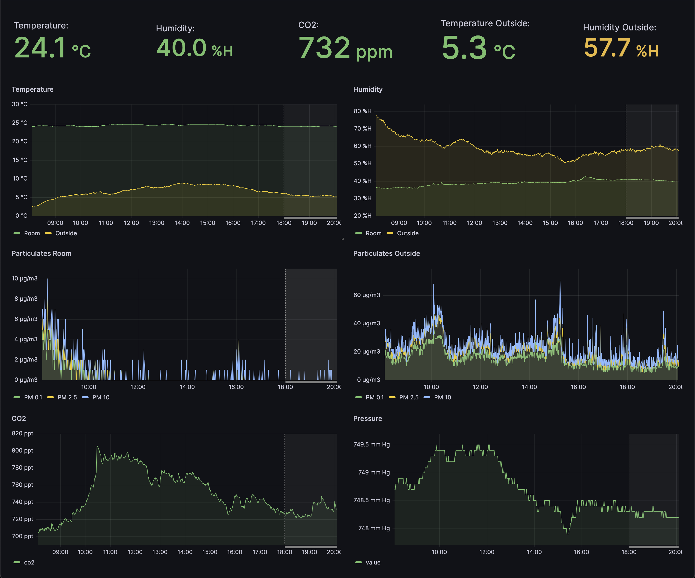

# esp-weather

Two ESP32 weather stations that work as one: the outdoor station radios its readings to the indoor one, which shows both on its screen and writes them to PostgreSQL. Grafana draws the graphs.

- **Indoor** (`esp-weather/`): BME280, SHT31, PMSA003, Senseair S8 (CO2) and an ILI9341 screen. Shows readings from both stations and a catgirl dressed for the weather outside.
- **Outdoor** (`esp-weather-small/`): same sensors minus the screen and CO2. No WiFi login and no database: it sends every reading to the indoor station over encrypted ESP-NOW.

Both stations read their sensors every 30 seconds. The stations come first, WiFi and the database are optional: with the router or PostgreSQL down, the screen keeps showing both stations and marks the missing uplink (`no WiFi`, `no DB`) in a status line; readings taken during an outage are not written later. If one sensor fails, its value shows `--` and its columns go NULL, the rest is still written.

## Setup

Server side (any machine with Docker):

```
docker-compose up -d
psql -h localhost -U postgres -d weather -f db.sql
```

Put Postgres and Grafana passwords in `.env`. Import `Grafana/MyRoomWeather.json` into Grafana at http://localhost:3000/grafana/.

Firmware (Arduino IDE, ESP32 board, core 3.x):

1. Install libraries: Adafruit_BME280, Adafruit_SHT31, PMserial, SimplePgSQL, and TFT_eSPI for the indoor station.
2. Link this repo's shared protocol library into the sketchbook once:
   `ln -s "$PWD/libraries/WeatherLink" ~/Documents/Arduino/libraries/WeatherLink`
3. Indoor only: in TFT_eSPI's `User_Setup.h`, uncomment the "For ESP32 Dev board" section.
4. In each sketch folder, copy `secrets.h.example` to `secrets.h`. Indoor: WiFi and database credentials. Both: the other station's MAC address (printed at boot, and as "MAC:" in the upload log) and the same two random 16-byte ESP-NOW keys.
5. Optionally set `DEFAULT_CHANNEL` in `libraries/WeatherLink/src/WeatherLink.h` to your router's channel (must be 1-11). It is where both stations meet after a cold boot; they find each other on other channels too, just a little later.
6. Flash. Serial monitor runs at 9600.

## Grafana dashboard



## The catgirl

The indoor screen shows a catgirl dressed for the current outdoor weather: scarf in the cold, snow coat below zero, umbrella in the rain, hand fan in the heat, face mask when PM2.5 is high. Tiles are 128x128 XBM headers in `esp-weather/tiles/`, picked by `pickCat()` in the indoor sketch.
